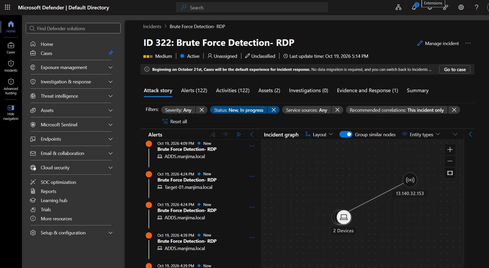
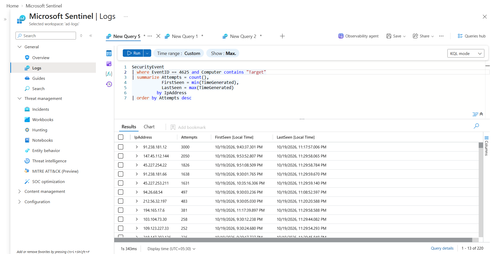
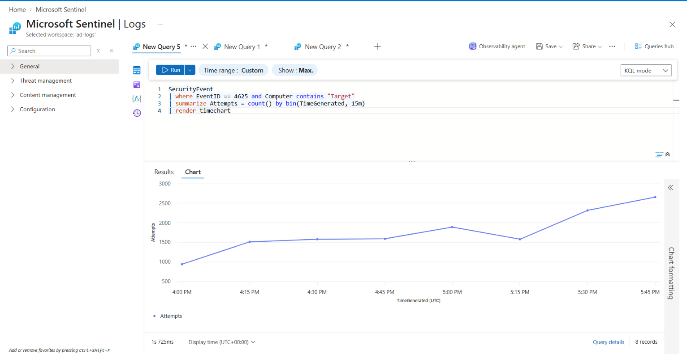
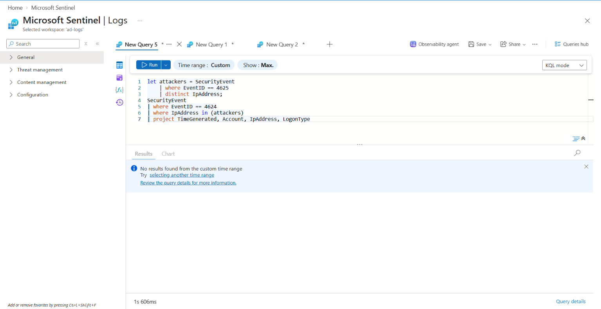

# Investigating an RDP Brute Force Alert in Microsoft Sentinel
 
A write-up of a real incident on my Azure lab VM: Sentinel flagged a burst of failed logons, and I worked out what was happening, whether anyone got in, and what to do about it.
 
| | |
|---|---|
| **Incident ID** | IR-2026-001 |
| **Analyst** | Manjima K |
| **Date** | 19 October 2026 |
| **Detected by** | Microsoft Sentinel |
| **Severity** | Low (no successful logons) |
| **Status** | Closed |
| **MITRE ATT&CK** | T1110.001 Password Guessing, T1595 Active Scanning |
 
## Background
 
This is a lab setup. I have a Windows 11 VM in Azure that I deliberately left with RDP (port 3389) open to the internet, with Sentinel watching it, so I could practise investigating real attack traffic.
 
On 19 October Sentinel raised an incident for a spike in failed logons. Between 16:00 and 18:00 UTC the VM logged **14,066 failed attempts** (Event ID 4625) from **220 IP addresses** trying **276 usernames**. None of them got in.
 
## How the logs get to Sentinel
 
Windows VM -> Azure Monitor Agent (data collection rule) -> Log Analytics workspace -> Microsoft Sentinel. Logon events end up in the `SecurityEvent` table.
 
The alert came from my Brute Force Detection- RDP analytics rule.
 

 
## Investigation
 
### 1. Who was attacking?
 
I started with failed logons grouped by source IP:
 
```kusto
SecurityEvent
| where EventID == 4625
| summarize Attempts = count(),
            FirstSeen = min(TimeGenerated),
            LastSeen = max(TimeGenerated)
          by IpAddress
| order by Attempts desc
```
 

 
Top sources (this is only the top of the list, so it doesn't add up to the full 14,066):
 
| Source IP | Attempts | Country | AbuseIPDB score |
|---|---:|---|---:|
| 91.238.181.12 | 3,000 | France | 33% |
| 147.45.112.144 | 2,050 | Germany | 100% |
| 45.227.254.22 | 1,826 | Lithuania | 21% |
| 91.238.181.66 | 1,638 | France | 13% |
 
Scores checked on 19 October 2026. Geolocation from AbuseIPDB.
 
### 2. What were they trying?
 
```kusto
SecurityEvent
| EventID == 4625
| summarize Attempts = count() by TargetUserName
| top 10 by Attempts desc
```
 
The most tried names were variations of `Administrator`, `admin`, `Azure`, etc. The scanners were clearly running a generic list and not tailoring it to a any particular host.
 
### 3. When did it happen?
 
```kusto
SecurityEvent
| where TimeGenerated > ago(24h) and EventID == 4625
| summarize Attempts = count() by bin(TimeGenerated, 15m)
| render timechart
```
 

 
The attempts looked like automated scanning and not someone targeting me. Peak rate was about 214 per minute around 5:58pm UTC.
 
### 4. Did anyone get in?
 
This was the question that mattered. I took every IP that had failed a logon and looked for successful logons (Event ID 4624) from any of them:
 
```kusto
let attackers = SecurityEvent
    | where EventID == 4625
    | distinct IpAddress;
SecurityEvent
| where EventID == 4624
| where IpAddress in (attackers)
| project TimeGenerated, Account, IpAddress, LogonType
```
 
No rows came back.
 

 
 
## Response
 
1. Restricted inbound RDP in the network security group so only my own IP can reach port 3389.
2. Confirmed in Sentinel that failed logons dropped to zero about 15 minutes later.
 
## Timeline (UTC, 19 October 2026)
 
| Time | Event |
|---|---|
| 16:12 | First brute force alert |
| 17:58 | Peak activity |
| 18:30 | I started investigating |
| 18:35 | Confirmed no successful logons from attacker IPs |
| 18:50 | NSG restricted to my IP |
 
## What I took away from it
 
I learned that detecting an attack wasn't just about identifying failed login attempts, but understanding the pattern, validating the evidence and assessing the security impact. An open RDP port gets hit quickly and at scale, and having Sentinel in place meant I could answer "did anyone get in?" with evidence and not a guess.
 
## Next steps
 
- [ ] Put RDP behind Azure Bastion or a VPN instead of exposing it
- [ ] Tune the alert rule so it fires earlier

 
---
 
Manjima K | [LinkedIn](www.linkedin.com/in/manjima-k) 
